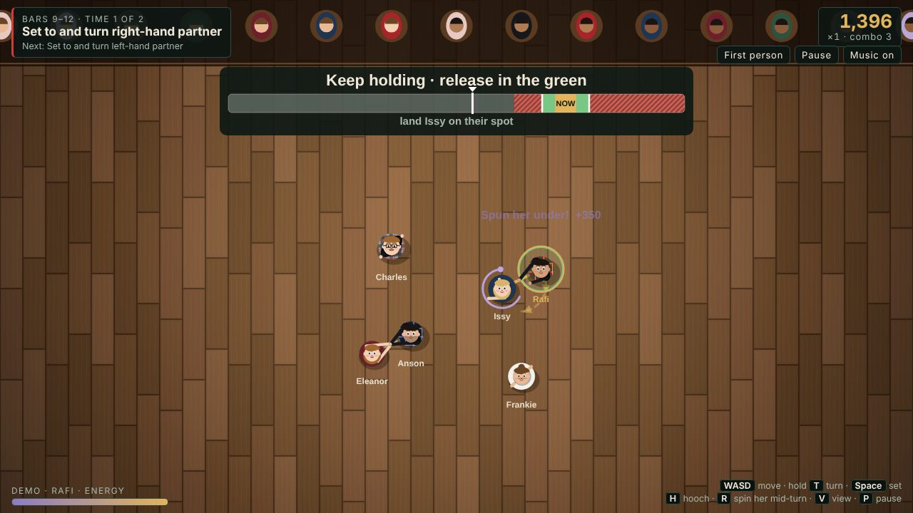
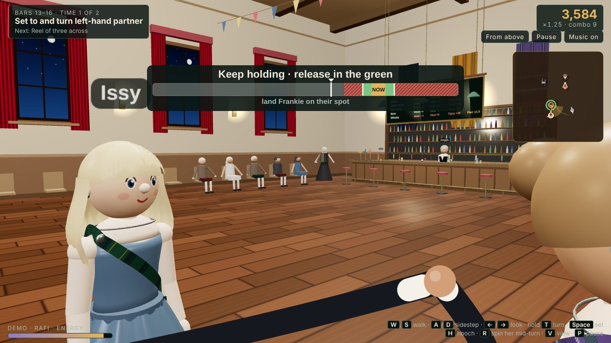
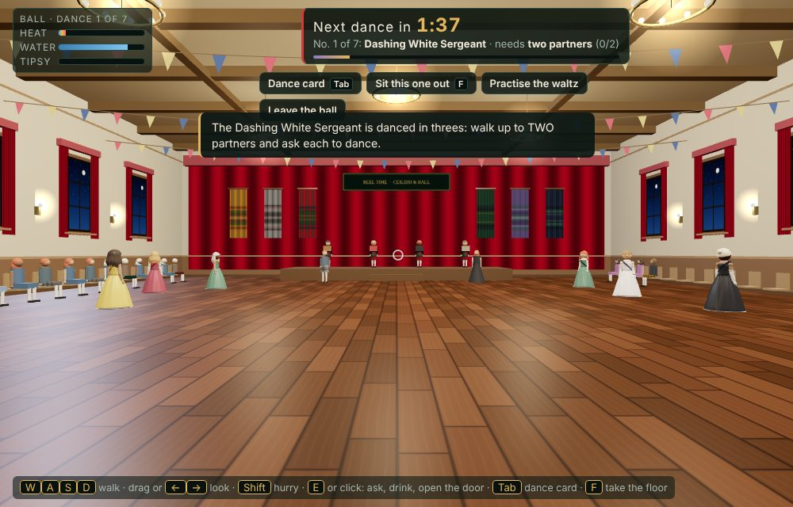
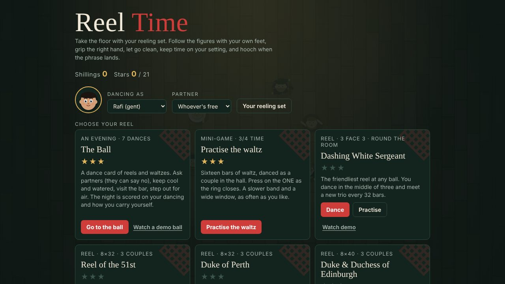

# Reel Time

A Scottish country dancing game that runs in the browser. You dance real reels, bar by bar, and you're scored on how well you follow the figures, take and let go of hands, keep time when you set, and hooch at the end of a phrase. Between dances you can walk round the ball itself.

**[▶ Play it here](https://rafimahmood.github.io/Reel-time/)** on a laptop, or on a phone held sideways.



## The dances

Each reel is built from the published dance instructions, bar by bar:

- The Dashing White Sergeant
- The Reel of the 51st Division
- The Duke of Perth
- The Duke and Duchess of Edinburgh
- The Foursome Reel
- The Eightsome Reel
- Strip the Willow

You unlock them in order by earning stars. There's also **The Ball**: an evening with a dance card of reels and waltzes. You ask partners (they can say no), keep cool and watered, visit the bar and step outside for air. The night is scored on your dancing and on how you carry yourself.



## How it plays

| | |
|---|---|
| **Move** | Hold forward to dance along the figure at the music's pace. Circles are left then right; advance and retire is forward then back |
| **SET** | Press when the marker on the timing bar is in the green. You step right, left, right and clap |
| **TURN** | Hold it to take hands and turn, then let go in the green to land your partner on their spot. Let go early and they spin past it; hang on and you drag them out of it |
| **SPIN** | Mid-turn, raise your right hand and spin her under it |
| **Flair** | Hooch at the end of a phrase, twirl, high cut, clap and stomp |
| **Views** | From above, or first person in a 3D ballroom (switch with **V**) |

Keyboard and touch both work. Phones get a joystick and buttons laid out for landscape. There are three difficulty levels, a practice mode, a Bluetooth audio-delay setting, and timing bars that don't rely on colour alone.

You can pick who you dance as and who your partner is from your own reeling set, and change each dancer's look. Shillings earned on the floor pay for training, tricks and tartans.



## How it's built

- **No build step.** Plain HTML, CSS and JavaScript, with no framework and no bundler. Open `index.html` and it runs.
- **2D view.** Drawn with the Canvas API.
- **3D view.** [three.js](https://threejs.org/) (r128). Everything is built in code from primitives: lathed kilts and gowns, a tartan texture woven pixel by pixel from real setts, and Mii-style faces painted onto canvas textures.
- **Choreography engine.** Each dance is a script of figures (turns, casts, circles, reels of three, sets) that generates every dancer's path through time. Scoring compares your position and button timing with that path.
- **The band.** It's synthesised live with the Web Audio API: musette accordion, second box, fiddle, piano vamp, bass and brushed drums. It plays the traditional tunes, read from ABC notation by a small parser written for the project. The game clock runs off the audio clock, so the steps stay in time with the music.
- **Testing.** Simulated players drive the game in a headless browser. They press slightly early or late on purpose, which is how difficulty and timing windows were tuned.

## Project layout

```
index.html          the page: HUD, menus and screens
css/style.css       all the styling
js/choreo.js        utilities and the choreography builder
js/dances.js        the seven dances, figure by figure
js/characters.js    your reeling set, faces, the wardrobe and tartans
js/save.js          save data (localStorage)
js/band.js          the Web Audio band and the ABC tune parser
js/game.js          game state, input actions, scoring, tricks, the demo dancer
js/view-2d.js       the view from above
js/view-3d.js       the first-person view and the ballroom (three.js)
js/ui.js            main loop, results, menus, character editor, Outfitter, controls
js/ball.js          The Ball: dance card, partners, meters, the waltz
js/ball-world.js    walking the hall, the bar and the terrace between dances
js/main.js          the closing embrace, start-up wiring and test hooks
tests/              automated tests (Playwright)
```

The scripts are plain `<script>` tags loaded in this order and share one global scope.

## Running it locally

Download the repo (**Code → Download ZIP**), unzip it and open `index.html` in Chrome, Safari or Firefox. The view from above works offline. The first-person view needs an internet connection to load three.js.

## Tests

See [`tests/README.md`](tests/README.md). In short: `npm install`, then `npm test`.

## Licence

MIT. See [LICENSE](LICENSE).


